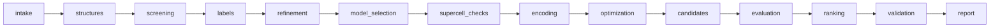

# What is implemented in `mofpipe`, and what the tests check

`src/mofpipe/` is a deterministic implementation of the pipeline specified in `instructions/`, with runtime LLM agents switched off. It covers three milestones of `instructions/10_AGENT_ARCHITECTURE.md`:

- **Milestone A:** schemas, persistence, job lifecycle and one tiny synthetic end-to-end fixture. It runs on `mof_no_agent_fixture/`, whose two 12-site substitution graphs (`ring12`, `prism6`) are **abstract test problems, not atomistic MOFs**.
- **Milestone B** (section 4): physical projects. A single binary topology goes from a CIF through built frameworks and periodic DFT labels to a grouped-validated energy model and a DFT ranking.
- **Milestone C** (section 6): several candidate topologies on one common formula unit, transferable cluster features, supercell transfer checks, declared acquisition with refinement rounds and stopping rules, relaxed-geometry deduplication, reference-phase competition, structural validation and the final report.

Periodic DFT runs through an engine adapter (section 5). **PySCF** is the primary engine: Gaussian-and-plane-waves (GPW) DFT on CPU or, through gpu4pyscf, on GPU. The Quantum ESPRESSO `pw.x` adapter is kept. The physical path is verified in three ways:
- the full Milestone B and C pipelines on **SYNTHETIC** toy frameworks driven by a mock `pw.x`, which test the bookkeeping;
- PySCF on tiny cells, where energies, forces, stress, k-point folding and relaxations are checked against independent calculations and finite differences;
- an opt-in PySCF end-to-end run on a SYNTHETIC aluminium-formate toy. At the shipped 20/25/30 Ha cutoff series it stops, correctly, at the cutoff-convergence gate (`DFT_SETTINGS_NOT_CONVERGED`): the energy difference between two decorations goes 2.94 → 0.66 → 0.03 Ha, grid error of the hard O/F GTH pseudopotentials. A completing PySCF run of a physical project has not been done here.

Passing results prove that the software path and its bookkeeping are correct. They say nothing about real MOF energetics. Everything not implemented is listed in [TODO.md](TODO.md).

Python ≥ 3.10. The pipeline core is standard-library Python. The PySCF engine needs `pyscf`, `pyscf-dispersion` and `ase` (`pyproject.toml`); the GPU switch also needs `gpu4pyscf`; tests use pytest. About 7,400 lines of pipeline code and 2,450 lines of tests.

```bash
PYTHONPATH=src python3 -m mofpipe matrix --project mof_no_agent_fixture/project.json --out runs   # 6 runs + acceptance
.venv/bin/python -m pytest -m "not pyscf"                                                       # 183 tests, ~3 min
.venv/bin/python -m pytest -m pyscf                                                             # 23 real-DFT checks, minutes
MOFPIPE_SLOW_TESTS=1 .venv/bin/python -m pytest -m pyscf -k end_to_end                          # PySCF pipeline on the formate toy
```

## 1. What the pipeline does

Fourteen stages run in a fixed order. Each one commits immutable artifacts to the run store; a failing stage halts the later ones, but the report is always written.



| Stage | Module | What it computes | Artifacts |
|---|---|---|---|
| intake | `intake.py` | Loads `project.json` and the learner-visible `data/` files. Refuses `harness/`, `reference_outputs/`, the oracle sources and paths outside the fixture. `validate_project` runs 80 checks: composition integral and consistent with building blocks, symmetry permutations bijective + closed + graph-preserving, no physical net name on a synthetic graph, model candidates well-formed, and every policy switch (agents off, quantum/DFT off, holdout blind, penalty > 0, bounded active learning, …). | `ValidationReport` |
| structures | `structures.py` | Enumerates the fixed-composition decoration space (924 states per graph). Computes symmetry orbits (50 / 55), cross-checks `candidates_unlabelled.jsonl`, verifies feature invariance under all 24 operations, and checks that edge swaps reach every state (QAOA XY-mixer prerequisite). Atomic construction is reported `SKIPPED_NO_ATOMIC_GEOMETRY`. | `DecorationSpace` |
| screening | `structures.py` | Identity screen: both graphs retained; there is no evidence for discarding either. | `ScreeningReport` |
| labels | `datasets.py` | Ingests training and development labels. Rejects mixed fidelity/unit/normalization/group, failed status, wrong provenance, recomputed ID mismatches, duplicates and wrong formula-unit counts. Freezes the orbit split (disjoint, covering all orbits) and refuses any learner label whose orbit is in the holdout. | `DatasetSnapshot`, `ValidationSplit` |
| refinement | `refinement.py` | Off by default (`DISABLED_BY_CONFIG`). When enabled: bounded active learning (≤ 3 iterations) that acquires base-fidelity labels for training-split orbits only and stops with `CONVERGED_WITHIN_SCOPE` / `MODEL_INADEQUATE` / `BUDGET_EXHAUSTED` / `INCONCLUSIVE`. | `RefinementReport` |
| model_selection | `configuration_model.py` | Fits each candidate model M0/M1/M2 per graph by exact rational least squares on training labels only, measures development RMSE, and picks the fewest parameters among those within the threshold (tie → model ID). Rank-deficient fits are recorded as failed; no passing model → `MODEL_INADEQUATE` and the run halts. The constant (graph offset) is kept. | `ModelSelectionReport`, `HamiltonianArtifact` |
| encoding | `encoding.py` | Compiles the physical polynomial plus `λ(Σx − 6)²` into a QUBO (constant, linear, upper-triangle-once quadratic). For the cubic M2, the QUBO target is rejected with `UNSUPPORTED_HIGHER_ORDER_WITHOUT_QUADRATIZATION` and a HUBO keeps every triplet term. The energy identity is checked exactly on all 4,096 bit strings, including infeasible ones; the penalized minimum must be feasible. | `EncodingArtifact`, `EncodingVerification` |
| optimization | `optimization.py` | Exact enumeration of the 924 feasible states, certified optimal, keeping all degenerate minimizers. Each state is re-scored with the physical model and cross-checked against the encoding. Simulated annealing exists as an uncertified heuristic. Optional: branch-and-bound cross-check and a QAOA simulation benchmark (Milestone D, section 7). QPU: `DISABLED_BY_CONFIG`. | `SolverResult` |
| candidates | `candidates.py` | Deduplicates by orbit within each graph. Keeps the best 5 unique orbits per graph plus every tie at the cutoff, with machine-readable selection reasons and degeneracy groups. | `CandidateSet`, `CandidatePool` |
| evaluation | `electronic.py` | Sends the pool to the expensive-evaluation boundary: the fixture's `tools/mock_evaluator.py`, run **as a subprocess** so the learner never imports the oracle formula. Jobs have idempotency keys and states; responses are checked for identity, units, normalization, fidelity, provenance and correction arithmetic. Base and corrected energies are separate fields with separate fidelities, and these labels are never used for training. DFT, embedding, FCI, VQE and SQD are reported as not executed. | `CalculationResult` |
| ranking | `ranking.py` | Ranks the pool separately at base and corrected level, after compatibility checks. Exact ties are recorded as true degeneracies, and coverage is stated as "screened finalist pool, not a global certificate". Reference-phase competition: `INCOMPLETE`. | `RankingReport`, `CompetitionReport` |
| supercell_checks | `orchestrator.py` | Abstract graphs have no supercells: `SKIPPED_NO_ATOMIC_GEOMETRY`. | — |
| validation | `ranking.py` | MOFChecker, CrystalNets, Zeo++, phonons, PXRD/NMR: all `SKIPPED_NO_ATOMIC_GEOMETRY`, never "passed". | — |
| report | `report.py` | `report.json` and `report.md`: stage statuses, model selection with reasons, Hamiltonians, encoding checks, minima, pools, rankings, static literature (`live_review: NOT_RUN`), a list of what was not executed, and an artifact index. | `ReportArtifacts` |

### Cross-cutting pieces

- **Shared contract (`contract.py`):**
  - One status vocabulary: `StageStatus`, `JobState`, `StopReason`.
  - `PipelineError`, whose `str()` is a stable code such as `INVALID_COMPOSITION`.
  - Exact rational energies, carried with float copies for reading.
  - Content-hashed records (`make_record`).
- **Run store (`store.py`):**
  - `state.json` is the authoritative workflow state, with a version counter.
  - `events.jsonl` is the event log.
  - Immutable, content-addressed `artifacts/` (rewriting an artifact with different content is an error).
  - `jobs/` holds evaluator requests and responses.
  - Writes are atomic.
  - A run directory is bound to its input fingerprint: other inputs → `RUN_DIR_BELONGS_TO_DIFFERENT_INPUTS`.
- **Resume (`orchestrator.py`):** A re-run with identical inputs reuses every committed stage. An interrupted run reuses finished evaluator jobs from the job cache, so expensive work is never submitted twice.
- **Agent boundary (`gateway.py`):** `review_proposal` validates a (replayed) proposal in the format from instructions/10:
  - project ID and state version (stale → rejected);
  - the role's tool permissions; `advance_workflow` is controller-only;
  - that every evidence artifact exists.

  With agents disabled it always rejects with `AGENTS_DISABLED`. No LLM is called anywhere.
- **Glue tools the briefs were missing:** `define_decoration_space`, `ingest_labels` / `merge_snapshots`, `freeze_split` and `CandidateSet` registration. These supply the IDs that the instruction tool signatures consume but never define.
- **Harness side (`acceptance.py`):** Runs only after a run is finalized. It is the only code that reads `harness/` and `reference_outputs/`, and it compares the report with the known answers and the bundled reference.

## 2. Results on the fixture

| Case | Correction | Selected model (both graphs) | Base minima ring / prism (eV) | Winner | Acceptance checks |
|---|---|---|---|---|---|
| core_pairwise | none | M1 | −0.120 / −0.160 | prism6 | 31/31 |
| core_pairwise | constant (+0.05 eV) | M1 | −0.120 / −0.160 → corrected −0.070 / −0.110 | prism6 | 29/29 |
| core_pairwise | topology_dependent | M1 | → corrected −0.120 / −0.100 | **ring12** | 29/29 |
| higher_order | none / constant / topology_dependent | M2 (cubic, HUBO) | same as above | prism6 / prism6 / **ring12** | 33/33 each |

Compared with the bundled reference implementation, the pipeline matches on:
- selected models;
- minima, minimizing bit strings (2 per graph) and ground-state orbits (1 per graph);
- orbit counts;
- the top-5 pools including cutoff ties, and the pooled ranking order with corrected energies;
- all QUBO coefficients.

On the untouched holdout, evaluated only after the run, the prediction error is 0.

## 3. What the tests check

106 tests in `tests/`, about 40 s. Tests may read `harness/` and `reference_outputs/`; the pipeline under test may not. Six full pipeline runs (2 cases × 3 correction modes) are shared across the end-to-end tests.

### `test_intake.py` (40 tests): inputs are strict and bad data is refused
| Test | Checks |
|---|---|
| `test_fixture_project_validates` | The real `project.json` passes every validation check. |
| `test_malformed_occupations_rejected` (×4) | Wrong ratio, wrong length, non-binary values and booleans give exactly `INVALID_COMPOSITION` / `INVALID_SITE_COUNT` / `INVALID_BINARY_OCCUPATION` (cases from `harness/negative_inputs.json`). |
| `test_incompatible_energy_records_rejected` (×6), `test_empty_energy_set_rejected` | Mixing hartree with eV, per-cell with per-formula-unit, another comparison group or another fidelity is refused, as are non-converged calculations and non-synthetic provenance. Each gives its specific error code. |
| `test_normalization` (×2), `test_invalid_formula_unit_count` (×4) | Normalization arithmetic is correct; formula-unit counts of 0, −1, 1.5 and `True` are rejected. |
| `test_ingest_rejects_corrupted_labels` (×4), `test_duplicate_label_rejected` | A label whose stated orbit or configuration ID disagrees with its bits, an unknown topology, a wrong formula-unit count, or a duplicate is refused. |
| `test_learner_cannot_read_harness_or_outside_files` (×3) | Pointing an input at `harness/`, `reference_outputs/` or outside the fixture raises `FORBIDDEN_LEARNER_INPUT`. |
| `test_runtime_agents_enabled_blocks_run` | Enabling agents blocks the run at intake. Later stages are `NOT_RUN`, and the report still gets written. |
| `test_policy_violations_block` (×9) | Zero penalty, holdout access during selection, A/B label exchange, a composition that does not sum to 12, dropping a graph without evidence, DFT on, quantum on, more than 3 active-learning iterations, and finite temperature on are each caught with the right code. |
| `test_symmetry_operation_that_breaks_graph_rejected`, `test_graph_relabelled_as_physical_net_rejected`, `test_cif_input_mode_unsupported` | A corrupted symmetry operation, renaming a synthetic graph to `pcu`, and an unsupported CIF input mode are all rejected. |
| `test_holdout_label_smuggled_into_training_halts_run` | A training file containing a holdout orbit stops the run at `labels` with `HOLDOUT_LABEL_IN_LEARNER_DATA`; no model is fitted. |

### `test_model_and_symmetry.py` (14 tests): symmetry, splits and model selection
| Test | Checks |
|---|---|
| `test_decoration_space_and_orbit_quotient` (×2) | 924 feasible states and 50 / 55 orbits per graph, as in `expected_results.json`. |
| `test_split_partitions_orbits_without_leakage` (×2), `test_split_with_leak_rejected` | The split counts are 30/10/10 (ring) and 30/10/15 (prism), the groups are disjoint, and a leaked orbit raises `ORBIT_LEAKAGE`. |
| `test_feature_symmetry_and_swap_reachability` (×2) | All features are invariant under all 24 operations on all 924 states, and edge swaps reach every feasible state. |
| `test_feature_polynomials_match_counts` (×2) | The polynomial form of each feature, used for encoding, equals its direct count. |
| `test_model_selection_and_untouched_holdout` (×2) | M1 is selected for core_pairwise and M2 for higher_order. Holdout RMSE ≤ 1e-10, and the graph offsets 0.12 / 0.20 eV are retained. |
| `test_rank_deficient_candidates_recorded_as_failed` | With 2 labels, M1/M2 are recorded as `RANK_DEFICIENT_FEATURES`, and selection returns `MODEL_INADEQUATE`. |
| `test_selection_is_policy_driven_not_hardcoded` | With M1 removed from the grid, the policy picks M2, and the answer is still correct. |
| `test_inadequate_family_halts_with_model_inadequate` | Higher-order data with only M0/M1 halts at model selection with `MODEL_INADEQUATE`; no encoding or winner is produced. |

### `test_encoding_and_solvers.py` (17 tests): compilation identities and solvers
| Test | Checks |
|---|---|
| `test_qubo_matches_fixture_reference_and_identity` (×2) | The QUBO coefficients equal the fixture's own `compile_pair_qubo`. The fixture's independent `evaluate_qubo` reproduces model + penalty on all 4,096 strings. The penalized minimum is feasible and equals the known minimum. |
| `test_cubic_model_rejected_by_qubo_only_target_but_retained_as_hubo` (×2) | M2 raises `UNSUPPORTED_HIGHER_ORDER_WITHOUT_QUADRATIZATION` for a QUBO target. The HUBO keeps all 12 / 36 triplet terms and passes the identity check. |
| `test_verifier_catches_tampered_encodings` (×3) | A double-counted quadratic term, a dropped constant or a dropped triplet is caught both by the 2ⁿ verifier and by the solver's decode cross-check (`ENCODING_DECODE_MISMATCH`). |
| `test_exact_enumeration_matches_known_minima` (×4) | For both cases and graphs: 924 states, the exact minimum, both minimizing bit strings, and certified status. |
| `test_simulated_annealing_agrees_with_exact` (×6) | Annealing with composition-preserving swaps reaches the exact minimum for 3 seeds × 2 graphs, and every output satisfies the composition. |

### `test_pipeline_end_to_end.py` (17 tests): the whole pipeline against known answers
| Test | Checks |
|---|---|
| `test_acceptance_against_harness_and_reference` (×6) | Runs `acceptance.check_run` (29–33 checks per run): completion, no agents, winner (expected and reference), and per graph the selected model, state and orbit counts, base minimum, minimizing strings, ground-state orbits, corrected minimum, holdout RMSE, pool identical to the reference, encoding kind and identity, QUBO coefficients (core/none), QUBO rejection and triplet retention (higher-order). Also the full ranked pool identical to the reference, the correction behaviour, and physical stages reported as skipped. |
| `test_constant_correction_preserves_full_order` (×2) | A constant +0.05 eV leaves the entire ranking order unchanged and shifts every energy by exactly 0.05. |
| `test_topology_dependent_correction_flips_winner` (×2) | Base winner prism6, corrected winner ring12; corrected pool minima −0.12 / −0.10 eV. |
| `test_bookkeeping_and_provenance` (×6) | Every stored artifact is SYNTHETIC, and training snapshots only ever carry base fidelity. Corrected = base + correction, and the surrogate equals the evaluated base. LLM calls are 0. Refinement is disabled, validation skipped, competition `INCOMPLETE`, DFT/embedding disabled, literature review `NOT_RUN`, and `report.md` is written. |
| `test_degeneracies_are_recorded_not_hidden` | Degenerate orbits in the ranking are marked as ties instead of silently ordered. |

### `test_isolation_and_resume.py` (7 tests): isolation, offline operation and persistence
| Test | Checks |
|---|---|
| `test_learner_never_touches_harness_oracle_or_network` | A Python audit hook records every file open, import, subprocess and socket event during a full run. Nothing under `harness/` or `reference_outputs/` is opened, and the oracle sources (`fixture_core.py`, `generate_fixture.py`, `oracle_definition.json`) are not touched. No oracle or network modules are imported and no socket is used. The only subprocess is the mock evaluator. |
| `test_rerun_reuses_every_stage_and_never_resubmits` | The second run reuses all 13 stages, produces an identical report artifact, and submits only one evaluator job in total. |
| `test_resume_after_interruption_during_evaluation_uses_job_cache` | Simulating a crash after the evaluator finished but before the stage commit, the resume hits the job cache instead of resubmitting, with an identical result. |
| `test_failed_evaluator_job_never_becomes_energy` | A crashing backend makes evaluation `FAILED`. Ranking is not run, and no winner or energy is fabricated. |
| `test_relative_run_dir` | A relative `--run-dir` works and nothing is written into the fixture (regression test for a bug found during development). |
| `test_acceptance_reports_failure_instead_of_crashing` | The acceptance checker reports `FAIL` on a broken run instead of raising. |
| `test_run_dir_bound_to_inputs` | Reusing a run directory with different inputs raises `RUN_DIR_BELONGS_TO_DIFFERENT_INPUTS`. |

### `test_refinement_and_gateway.py` (11 tests): active learning and proposal validation
| Test | Checks |
|---|---|
| `test_active_learning_recovers_cubic_model_from_sparse_start` | Starting from 2 labels per graph (higher_order), active learning converges within 3 iterations and selects M2. Every acquired orbit is in the training split, never development or holdout. The final answer is correct, and evaluator submissions equal AL batches + 1. |
| `test_more_labels_cannot_fix_missing_interaction_term` | With only M0/M1 available, the loop stops immediately with `MODEL_INADEQUATE` and submits zero evaluator jobs. |
| `test_budget_exhaustion_is_not_convergence` | A too-small budget stops with `BUDGET_EXHAUSTED`. The stage is `INCONCLUSIVE`, and the pipeline is not reported complete. |
| `test_replayed_proposals_are_validated_and_never_executed` (×7) | The instructions/10 proposal format is validated: a valid proposal is rejected with `AGENTS_DISABLED`. Stale state, an unknown role, a tool outside the role, the controller-only `advance_workflow`, unknown evidence and a wrong project are each rejected with their own code, and nothing is executed. |
| `test_malformed_proposal` | A proposal missing required fields → `MALFORMED_PROPOSAL`. |

### Do the tests catch real bugs?

Four deliberate bugs were injected one at a time, and the suite caught each:
- dropping cutoff ties from the pool;
- a wrong penalty constant;
- letting active learning acquire holdout orbits;
- selecting the most complex passing model.

## 4. Milestone B: physical projects

`intake.load_project` recognises a ProjectSpec v0.1 file (the `instructions/project_spec.template.json` shape) or a `physical_case/recipe.json`. Either one loads into the same `ProjectSpec` with `project_type = "physical_structure"`, and the orchestrator then picks `_physical_*` stage variants where the fixture path does not apply. The stage order is unchanged.

| Stage | Physical-project behaviour | Module |
|---|---|---|
| intake | One `SCIENTIFIC_SPEC_MISSING` error per null/empty required field, with its path (28 for the untouched template). CIF checksum, disorder and guest policy, building-block declarations, connector counts, node connectivity, integral sublattice counts, inventory per formula unit and charge balance are all checked here, before any calculation. Pseudopotential hashes and DFT protocol fields are verified too. | `project_spec.py`, `cif.py`, `framework.py`, `dft.py` |
| structures | Slot lattice from the CIF: periodic bond graph → nodes and linkers → slots, with contact-weighted distance-1 pairs, distance-2 pairs, triplets, and permutations from space-group operations × supercell translations. The known parent is rebuilt and must match the parsed supercell exactly. | `framework.py` |
| labels | A seeded orbit split (training / frozen holdout / unlabelled) is fixed before any energy exists. Next, a cutoff convergence study of an energy difference runs, and an unconverged cutoff blocks the run. Then every labelled orbit is built and relaxed, with a final single point and each declared magnetic state. Failed and transformed calculations are recorded, never labelled. | `orchestrator.py`, `dft.py`, `datasets.py` |
| model_selection | Grouped K-fold CV with a documented rank-deficiency gauge and optional ridge. CV RMSE and tie-aware low-energy recall against the declared tolerances; fewest effective parameters wins. The frozen holdout is evaluated once afterwards. | `configuration_model.py` |
| encoding → candidates | Unchanged; they act on the CIF-derived `TopologySpec`. | |
| evaluation | Each pool candidate goes through build → DFT. Labelled candidates come from the job cache. Failures become missing evaluations. | `orchestrator.py` |
| ranking | DFT-only base ranking; differences within `target_relative_energy_tolerance` are ties. The corrected ranking is `DISABLED_BY_CONFIG`. | `ranking.py` |
| validation | Builder sanity, post-relaxation slot mapping and residual force/stress counts; external tools are `SKIPPED`. | `orchestrator.py` |

**Toy result** (`tests/toy_framework.py`):
- Input: a Pm-3m Zn/linker net and a 2×2×1 cell, with 12 slots, 4 nodes, 2 formula units, 32 slot permutations and 56 orbits.
- Labels: 44 training and 12 holdout orbits.
- The 80 Ry cutoff is converged to 2.2 meV per formula unit for the energy difference; 60 Ry is not.
- Selection: M0 is selected, with CV RMSE 0.24 meV per formula unit and holdout RMSE about 0.3 meV.
- Evaluation: the 6 pool candidates (top 3 plus cutoff ties) all come from the job cache, so no DFT job runs twice. Their DFT energies lie within 1.1 meV per formula unit, so the ranking reports them as ties within the 5 meV tolerance instead of a strict order.

The mock energy has a node-mediated N–N term plus a weak orientation-dependent term that the slot features cannot represent, so the CV error is not zero.

### Tests (55 new)

| File | Checks |
|---|---|
| `test_physical_intake.py` (30) | **T01.1:** template → exactly the required paths, once each; template run blocks at intake and still reports; recipe → separate PHYSICAL project blocked on its missing inputs; formula parsing; physical and synthetic projects cannot share a run dir; fixture case modes refused; nested protocol fields, science-changing retry steps, unconverged-series spec, unsupported later-milestone fields; pseudopotential tampering; protocol registry files. **T01.2:** symmetry expansion and checksum; slot lattice counts, degrees, contact weights, group checks; slot mapping identical for reversed and random atom order (P1 input keeps only translations); disorder, non-integral ratio, charge, inventory, checksum and guest errors all block before any job; wrong connector/connectivity declarations; guest removal only under the declared policy. **T01.3:** every symmetry-distinct legal decoration builds with the target inventory; builds reproduce identical artifacts; CIF export round-trips; parent rebuild identical; an overlapping substituent gives `ATOM_OVERLAP` and no DFT job; PORMAKE adapter never fabricates geometry. |
| `test_physical_dft_and_model.py` (25) | **T06.1:** QE input carries every scientific setting; relax + single point normalised by verified formula units; SCF retry changes only the declared numerics; unconverged relaxation, residual force, lost atom, topology change and crash never yield energies; reordered atoms give the same normalised energy and a symmetry image agrees within tolerance; a z-replicated cell gives the same energy per formula unit; a restarted backend reuses jobs; budget, missing executable and unconverged cutoff block. **T06.2:** full physical run completes; every ranked energy traces to a stored CalculationResult and Geometry; tolerance ties; rerun and mid-label resume submit no new DFT jobs; a build failure in the pool makes the ranking `INCOMPLETE`. **T03.2:** fewest-parameter model with the documented gauge; no orbit crosses train/holdout and folds are deterministic; `fail` gauge policy and too-tight tolerance give explicit failures; a perturbed Hamiltonian fails the holdout; gauge/ridge/recall helpers; physical and fixture snapshots never merge. |

## 5. Periodic DFT engines (Task 06)

`dft.PeriodicDFTBackend` keeps the `submit → job_status → collect` interface from Milestone B. The engine is chosen by `protocols.dft.engine` and sits behind one adapter interface (`write_input` / `parse_output`, raw output kept per attempt):

| Engine | Adapter | What runs |
|---|---|---|
| `pyscf` | `dft.PySCFAdapter` + `pyscf_worker.py` | One subprocess per calculation in the protocol's interpreter (`command`, e.g. `[".venv/bin/python"]`). Gaussian orbitals with GTH basis sets and pseudopotentials (`basis`, `pseudo`: one name or a per-element map, so a larger metal basis can be combined with lighter organic ones). The density and potentials are on plane waves (`ke_cutoff_Ha`). `integral_scheme: multigrid` is CP2K-style multigrid GPW at the Gamma point; `fftdf` is FFT GPW with any Monkhorst–Pack mesh. DFT-D3(BJ/zero/…, optional ATM) or D4 comes from pyscf-dispersion (energy, gradient, virial). Relaxations use ASE BFGS/LBFGS/FIRE, with FrechetCellFilter for `vc-relax`. `device: gpu` runs SCF, gradients and stress through gpu4pyscf (`to_gpu`). |
| `quantum_espresso` | `dft.QuantumEspressoAdapter` | `pw.x`, unchanged apart from the fixes listed below. |

**PySCF engine details:**
- **Identity.** At start-up the backend probes the worker interpreter. It records the versions (pyscf, pyscf-dispersion, gpu4pyscf, worker) and SHA-256 hashes of the basis and pseudopotential parameters actually loaded for every element. These are part of the protocol hash, so the fidelity changes when PySCF or its data change. The probe also refuses a protocol before any job runs:
  - hybrid, meta-GGA or NLC functionals → `UNSUPPORTED_DFT_PROTOCOL`, because periodic forces/stress need LDA/GGA;
  - dispersion damping parameters missing for the functional;
  - no CUDA device for `device: gpu` → `BACKEND_UNAVAILABLE`.
- **Units and conventions.** Energies are Hartree in the raw output and are converted exactly (`HARTREE_TO_EV = 2 × RY_TO_EV`, CODATA 2018). Stress is (1/V) dE/dε, so a compressed cell has negative diagonal stress and pressure = −tr/3.
  - With smearing (`occupations.kind: smearing`, `method`, `sigma_Ha`), `zero_smearing_convention` selects `internal_energy`, `free_energy` or `zero_temperature_extrapolated`.
  - Relaxations always minimise the variational energy whose derivatives the forces are: E, or F with smearing.
- **Stress with multigrid.** PySCF's multigrid integrator has gradients but no stress, so the stress is evaluated with the FFTDF integrator at the converged GPW orbitals. This equals the derivative of the GPW energy only when both integrators agree for that density. The worker computes both energies and refuses (`STRESS_INTEGRATOR_INCONSISTENT`) when they differ by more than 1e-4 Ha per atom; the remedy is a higher `ke_cutoff_Ha` or `integral_scheme: fftdf`. The FFTDF scheme and the GPU path have their own consistent stress.
- **k-points.** The mesh comes from `kpoint_spacing_inv_A` for each geometry. Intake refuses `multigrid` when that spacing needs more than Gamma (`UNSUPPORTED_KPOINTS_FOR_MULTIGRID`).
- **Retries.** Only `damp`, `level_shift`, `diis_space`, `diis_start_cycle` and `max_cycle` may change between attempts.
- **Cutoff convergence.** The convergence study varies `ke_cutoff_Ha` (`difference_convergence.ke_cutoff_Ha_series`).
- **Not supported:** DFT+U (`UNSUPPORTED_HUBBARD_U`), hybrids, and user-supplied basis files.

**Changes to the Milestone B result checks** (found in review; they apply to every engine):
- Residual forces are acceptance criteria only for geometries the protocol relaxed (`relax`, `vc-relax`). Residual stress applies only after `vc-relax`.
  - Previously the stress gate also ran after a fixed-cell `relax` and on its final single point, so a fixed-cell protocol would have rejected almost every label.
  - A protocol may now declare `relaxation.calculation: "scf"` (rigid builder geometries). Every result records its `geometry_purpose`.
- The stress check uses the full tensor (max |σᵢⱼ|) rather than the hydrostatic pressure, which let anisotropic residual stress pass. The QE parser now reads the stress tensor.
- `pw.x` tests every Cartesian force component against `forc_conv_thr`, while the post-check uses the vector norm. The threshold is now tolerance/√3, so a relaxation QE reports as converged is no longer rejected.
- A `vc-relax` output with final coordinates but no parseable `CELL_PARAMETERS` block is a parse error, instead of silently keeping the input cell.
- `stress_tolerance_and_units.units` accepts `kbar` or `GPa`.

**Tests (`test_pyscf_backend.py`, 23, marker `pyscf`):**

| Test | Checks |
|---|---|
| `test_worker_energy_equals_direct_pyscf_plus_d3` | The worker's total energy equals an independent PySCF multigrid RKS energy plus the DFT-D3(BJ) energy to 1e-7 Ha; versions, data hashes, mesh and k-mesh are recorded. |
| `test_forces_and_stress_match_finite_differences` (×2) | For multigrid (Gamma) and FFTDF (2×2×2 k-mesh), the DFT+D3 forces equal central differences of the energy (≤ 2e-4 eV/Å). The diagonal and shear stress equal strain derivatives (≤ 2e-5 eV/ų). |
| `test_kpoint_mesh_equals_replicated_cell_at_folded_mesh` | A primitive Si cell at a 2×2×2 mesh and the cell doubled along a₃ at 2×2×1 (both from the same k-spacing) give the same energy per primitive cell (≤ 2e-5 Ha). |
| `test_smearing_conventions_and_reported_energy` | E_free ≤ E, E_zero = (E + E_free)/2, and the declared convention is the reported energy. |
| `test_relax_reaches_the_declared_force_tolerance`, `test_vc_relax_reaches_the_declared_stress_tolerance` | ASE relaxations stop only when max ‖F‖ ≤ tolerance (H₂ from 1.0 Å) and max |σᵢⱼ| ≤ tolerance (Si strained by 4 %), and record the trajectory. |
| `test_scf_failure_is_reported_without_energy`, `test_unsupported_settings_raise_typed_errors` | An unconverged SCF gives no energy. A science-changing retry key and a k-mesh with multigrid give typed errors. |
| `test_pyscf_protocol_errors_block_at_intake` (×9) | Multigrid with a k-mesh, Hubbard U, a science-changing retry, a cutoff series without a higher cutoff, an unknown dispersion, a QE-only energy convention, a basis map missing an element, an unknown device and an unknown engine are each caught at intake with their field path. |
| `test_engine_identity_is_part_of_the_fidelity`, `test_pyscf_job_input_carries_every_scientific_setting` | The probe records versions and per-element hashes; a different PySCF version gives a different protocol hash. The job file carries every setting. |
| `test_probe_refusals_block_the_labels_stage` (×2) | `device: gpu` without gpu4pyscf and a hybrid functional block the labels stage before any job. |
| `test_pyscf_physical_pipeline_end_to_end` (opt-in) | The physical pipeline on the SYNTHETIC aluminium-formate toy with real GPW single points. At the shipped cutoffs it must stop at labels with a named code (it does: `DFT_SETTINGS_NOT_CONVERGED`). With a converged cutoff every ranked energy must trace to its Hartree raw energy. |

## 6. Milestone C: several topologies, transfer, refinement, references

| Piece | What it does | Module |
|---|---|---|
| Several topologies | `candidate_topology_ids` may list several structures, one `source_structures` entry each, with their own supercell matrices. Slot counts, encoded-site counts, composition and formula units are per topology (`TopologySpec.n_ones`, `composition`). Every topology is checked against the same `target_elemental_inventory`, and labels share one comparison group (formula unit + DFT fidelity), so the pooled ranking compares like with like. The cutoff convergence study covers the difference inside each topology and the cross-topology difference that the pooled ranking relies on. | `project_spec.py`, `orchestrator.py` |
| Cluster orbits (T03.1) | Point and pair clusters of slots are classified by the parent space group (rotation + fractional + lattice translation). Orbit identities therefore do not depend on the supercell, and inequivalent pairs at equal distance stay separate (the toy has two inequivalent 8.1 Å orbits). Features are counts per formula unit with every periodic image. Model candidates request them as tokens: `point_orbits`, and `pairs<=R` for every pair orbit with slot-centroid distance ≤ R Å. | `clusters.py`, `configuration_model.py` |
| Supercells (T01.5) | Extra supercell matrices are transfer cells (`<topology>@AxBxC`). The structures stage checks exactly that every working-cell orbit, replicated, has identical features and lands in one transfer orbit. The `supercell_checks` stage then runs DFT on: <br>• replicated low-energy labels, which must match the working-cell energy within tolerance; <br>• seeded native transfer-cell orderings, compared with the working-cell model's per-formula-unit predictions. <br>Failures are reported (`TRANSFER_VALIDATION_FAILED`). Intake refuses non-transferable features (`unlike_distance_*`, `site_orbit_*`) when transfer cells exist. | `transfer.py` |
| Acquisition (T05.2) | Policy `protocols.acquisition` sets `batch_size`, `weights` (energy, uncertainty, diversity), `audit_fraction`, `min_per_topology` and `seed`. <br>• Scores: the normalised predicted energy, the committee spread of the grouped-CV fold models (not a bound), and the feature-space distance to labelled and already-chosen orbits. <br>• A seeded audit share comes from the deprioritised half. <br>• Quota beyond the minimum goes to topologies by need: CV error, failing model, few labels. <br>• Only unlabelled, never-attempted orbits outside the frozen holdout are eligible. <br>Each pick records its reason, score components and the model it used. | `acquisition.py` |
| Refinement (T08.1/T08.2) | Enabled by `protocols.stopping` (`max_rounds`) together with `tolerances.consecutive_stable_rounds`. Each round refits every topology by grouped CV, acquires a batch and labels it by DFT. Stop reasons: <br>• `CONVERGED_WITHIN_SCOPE`: every topology passes and the leading set (orbits within tolerance of the k-th lowest prediction, per topology and pooled) is unchanged for the declared number of rounds; <br>• `MODEL_INADEQUATE`: every candidate is well determined and fails; <br>• `INCONCLUSIVE`: a topology needs labels and has none left; <br>• `BUDGET_EXHAUSTED`: round cap or DFT budget. <br>Interrupted rounds resume from the job cache. | `refinement.py`, `orchestrator.py` |
| Relaxed-geometry dedup (T05.1) | Two relaxed structures are equivalent if they have the same inventory and magnetic state, lattices within 1 %, and an operation of the parent space group × supercell translations maps every atom onto a same-element atom within `protocols.validation.geometry_equivalence_tolerance_A`. Energies are never used. The classes are the CV groups and are reported for the evaluated pool. | `geometry_match.py` |
| References (T09.2) | `protocols.validation.reference_phases: "pure_endpoints"` evaluates every topology with all slots of one species; these are normalised per cell. The mixture balance min Σcᵢ Eᵢ subject to Σcᵢ·inventoryᵢ = target, c ≥ 0 is solved exactly over the basic feasible solutions. Mixing energies are reported per finalist, and the competition stays `INCOMPLETE` unless the project declares its reference set complete. | `references.py` |
| Validation (T09.1) | Every finalist gets: <br>• post-relaxation slot/node mapping; <br>• residual force/stress, or `NOT_APPLICABLE` for rigid geometries; <br>• minimum interatomic distance; <br>• metal coordination numbers against the parent; <br>• cell distortion. <br>MOFChecker and Zeo++ run when installed, otherwise `SKIPPED_TOOL_UNAVAILABLE`. Phonons, PXRD, NMR and CrystalNets are `NOT_RUN`. | `validation.py` |
| Report | Adds the refinement rounds, transfer checks, reference competition, finalist validation, relaxed-geometry classes, cluster catalogue, search coverage per topology and a reproducibility manifest (inputs, fidelity, engine identity, job counts). | `report.py` |

**Toy result** (`write_toy_milestone_c_project`, mock `pw.x`, ~50 s):
- **Inputs.** `toy_pcu` (2×2×1 working cell, 2×2×2 transfer cell) and its staggered polymorph (2×2×1), each with 56 orbits.
- **Labels.** The cutoff is converged for both topologies and the cross difference. There are 9 seed labels plus 3 holdout per topology.
- **Refinement.** Converged after one acquisition round, at 11 labels per topology.
- **Model.** The two-shell cluster model was selected for both topologies; the holdout RMSE is ≤ 0.17 meV per formula unit.
- **Transfer.** Replication agrees to 0.65 meV per formula unit; the native transfer RMSE is 0.9 meV (tolerance 5 meV).
- **Ranking and references.** The pooled ranking spans both structures. All 4 pure endpoints are evaluated; the competition is `INCOMPLETE` because the reference set is not declared complete.

**Tests (`test_milestone_c.py`, 22):**
- **Full run.** Common reference and cross-topology convergence; every report section present; rerun and an interrupted refinement submit no new DFT jobs.
- **Cluster orbits.** Inequivalent equal-distance pairs stay separate; symmetry invariance; the polynomial equals the count.
- **Transfer.** Exact replication of features and orbits; a deliberately wrong model fails the transfer check; native states are seeded and are not replicas.
- **Acquisition.** Picks come only from unlabelled orbits and carry reasons, including audit picks; selection is reproducible from its seed; the under-sampled, failing topology gets the larger quota.
- **Stopping.** Convergence needs consecutive stable rounds; a moving leading set at the round cap is `BUDGET_EXHAUSTED`; an exhausted pool is `INCONCLUSIVE`; well-determined failure is `MODEL_INADEQUATE`. A full run whose round cap comes before stability is `BUDGET_EXHAUSTED`, not `COMPLETED`.
- **Geometry equivalence.** A symmetry image with reordered atoms and noise is equivalent; another decoration or another magnetic state is not.
- **References.** The exact mixture balance picks the lower polymorph; an unreachable composition gives no balance; missing references keep the competition `INCOMPLETE`.
- **Validation.** Absent tools are reported as skipped; an overlapping atom fails the distance check.
- **Intake.** Errors for: missing transfer policy, non-transferable features, missing stable-round count, negative weights, a topology/source mismatch, an unknown reference set. Each topology keeps its own cell counts.

## 7. Milestone D: quantum optimisation benchmark and electronic active-space solvers

| Piece | Module | What it does |
|---|---|---|
| Quadratization (T03.4) | `encoding.py` | Policy `higher_order: "quadratize"`. Rosenberg substitution of cubic terms with one ancilla per pair and a stated penalty M = 2·Σ\|c\|. Verification minimizes over ancillas on all 2ⁿ decision strings. Fixture `higher_order`: ring12 11 ancillas, prism6 23, exact identity, feasible minimum, unchanged winner. |
| Constraints and bounds (T03.5) | `encoding.py` | One count constraint per sublattice. Every encoding records the single-flip penalty bound L (λ > L certifies a feasible minimum without enumeration). One-hot QUBO for >2 species per slot, certified exhaustively on small instances. |
| Branch and bound (T04.1) | `optimization.py` | Exact fixed-count minimization in integer arithmetic. Certified on completion; at a node or time limit it returns the greedy-seeded incumbent with lower bound and gap. Optional cross-check against enumeration in the optimization stage. |
| QAOA simulation (T04.2) | `qaoa.py` | Feasible-subspace statevector, XY exchange mixer over `pairs_distance_1`, Dicke initial state, seeded Nelder–Mead, shots, decode and re-evaluate. Full-register mixer-constraint check. Benchmark against exact and annealing across seeds. Recorded in the optimization stage as `QuantumBenchmark`; it never changes the candidate pool. |
| Active space (T07.1) | `active_space.py` | PySCF RHF/ROHF → CASCI integrals → FCIDUMP + `ActiveSpaceArtifact` (h1, h2, E_core, spin counts, ordering, convention, hashes, orbital character). Bare systems only (`embedding: none`). |
| Electronic solvers (T07.2) | `electronic_solvers.py` | Independent determinant ED, PySCF CASCI on the stored integrals, Jordan–Wigner UCCSD VQE (simulated), SQD from simulated samples with recovery; hardware SQD `BLOCKED`. All share one `hamiltonian_hash`. |

**Published benchmark** (`benchmarks/h2_sto3g_szabo_ostlund.json`, CLI `electronic-benchmark`): minimal-basis H₂ at R = 1.4 a₀. HF is −1.11671 Ha against the published −1.1167, full CI −1.13728 against −1.1373. ED, CASCI, VQE and SQD agree; status `REPRODUCED`. On LiH CAS(4,4), ED and PySCF FCI agree to 10⁻¹⁴ Ha, UCCSD-VQE is 8×10⁻⁹ Ha above, and SQD stays variational.

### Tests (`test_milestone_d.py`, 8)
- **Quadratization:** default policy still rejects a cubic QUBO; ancilla-minimized identity exact; feasible minimum; a wrong ancilla decode rule is caught.
- **Constraints and one-hot:** penalty bound certification and its honest failure for λ = 0.001 eV; two-sublattice counts; one-hot encoded minimum equals the physical minimum and is feasible.
- **Branch and bound:** agrees with enumeration on six Hamiltonians, frustrated ones included; at a node limit, lower bound ≤ optimum ≤ incumbent.
- **QAOA mixers:** exchange mixer preserves binary and one-hot constraints, the X mixer does not; exchanges stay within the multicomponent feasible set; a mislabelled coupling is caught as `ENCODING_DECODE_MISMATCH`.
- **QAOA benchmark:** reaches the exact minimum for every seed, amplifies the optimum above 10× uniform, and records full provenance.
- **Pipeline:** quadratize + branch and bound + QAOA on the fixture completes with the expected winner; a QPU protocol is refused.
- **Electronic solvers:** LiH CAS(4,4) export is reproducible with an exact FCIDUMP round trip; ED = CASCI; VQE ≥ ED within 10⁻⁶; SQD variational; identical hash everywhere; embedding refused.
- **Published H₂:** the CLI reproduces it within 10⁻⁴ Ha; VQE matches ED; hardware SQD is blocked; the correction is `UNVALIDATED`.

## 8. What the tests do not establish

- **MOF physics.** No real MOF structure, ML potential, embedding or quantum circuit is involved. The fixture corrections are artificial bookkeeping tests.
  - The PySCF engine is checked against independent PySCF calculations and finite differences on tiny cells (Si₂, H₂), and end to end on a SYNTHETIC formate toy. That shows the energies, forces and stresses it returns are the derivatives of the energy it reports. It does not show that a minimal GTH basis, a given cutoff or Gamma-point sampling is adequate for a MOF; that is what the convergence studies of a real project must establish.
  - The QE adapter is exercised only against a mock `pw.x`; its input/output handling still has to be checked on a real installation.
  - The GPU path follows the gpu4pyscf 1.8 API but has never run here: no CUDA device was available.
- **Scaling.** Exact enumeration and the 2ⁿ encoding check are feasible only for these 12-site graphs.
- **Real-data model selection.** The near-zero RMSE threshold is valid only because the fixture labels are exact.
- **Active-learning quality.** The tests show the loops are bounded, holdout-safe, reproducible from their seed and stop honestly. They do not show that the acquisition policy is efficient on real data.
- **Topology identity.** The two Milestone C toy structures are a conformational pair on the same net. The code treats each parent CIF as a candidate structure; it does not verify that two CIFs are different nets (CrystalNets/MOFid are not wired).
- **Agents.** Only proposal validation is tested; no agent ever runs.

See [TODO.md](TODO.md) for what each missing piece requires.
