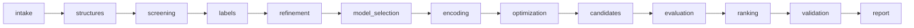

# What is implemented in `mofpipe`, and what the tests check

`src/mofpipe/` is a deterministic implementation of the pipeline specified in `instructions/`, with runtime LLM agents switched off. It covers two milestones of `instructions/10_AGENT_ARCHITECTURE.md`:

- **Milestone A:** schemas, persistence, job lifecycle and one tiny synthetic end-to-end fixture. It runs on `mof_no_agent_fixture/`, whose two 12-site substitution graphs (`ring12`, `prism6`) are **abstract test problems, not atomistic MOFs**.
- **Milestone B** (section 4): physical projects. A single binary topology goes from a CIF through built frameworks and periodic DFT labels to a grouped-validated energy model and a DFT ranking. It is verified only on a **SYNTHETIC** toy framework driven by a mock `pw.x`.

Passing results prove that the software path and its bookkeeping are correct. They say nothing about real MOF energetics. Everything not implemented is listed in [TODO.md](TODO.md).

Python ≥ 3.10, standard library only; pytest for tests. About 4,350 lines of pipeline code and 1,550 lines of tests.

```bash
PYTHONPATH=src python3 -m mofpipe matrix --project mof_no_agent_fixture/project.json --out runs   # 6 runs + acceptance
python3 tests/toy_framework.py runs/toy_project                                                  # write the SYNTHETIC toy physical project
PYTHONPATH=src python3 -m mofpipe run --project runs/toy_project/project.json                    # CIF -> DFT (mock pw.x) -> model -> ranking
python3 -m pytest                                                                                 # 161 tests
```

## 1. What the pipeline does

Thirteen stages run in a fixed order. Each one commits immutable artifacts to the run store; a failing stage halts the later ones, but the report is always written.



| Stage | Module | What it computes | Artifacts |
|---|---|---|---|
| intake | `intake.py` | Loads `project.json` and the learner-visible `data/` files. Refuses `harness/`, `reference_outputs/`, the oracle sources and paths outside the fixture. `validate_project` runs 80 checks: composition integral and consistent with building blocks, symmetry permutations bijective + closed + graph-preserving, no physical net name on a synthetic graph, model candidates well-formed, and every policy switch (agents off, quantum/DFT off, holdout blind, penalty > 0, bounded active learning, …). | `ValidationReport` |
| structures | `structures.py` | Enumerates the fixed-composition decoration space (924 states per graph). Computes symmetry orbits (50 / 55), cross-checks `candidates_unlabelled.jsonl`, verifies feature invariance under all 24 operations, and checks that edge swaps reach every state (QAOA XY-mixer prerequisite). Atomic construction is reported `SKIPPED_NO_ATOMIC_GEOMETRY`. | `DecorationSpace` |
| screening | `structures.py` | Identity screen: both graphs retained; there is no evidence for discarding either. | `ScreeningReport` |
| labels | `datasets.py` | Ingests training and development labels. Rejects mixed fidelity/unit/normalization/group, failed status, wrong provenance, recomputed ID mismatches, duplicates and wrong formula-unit counts. Freezes the orbit split (disjoint, covering all orbits) and refuses any learner label whose orbit is in the holdout. | `DatasetSnapshot`, `ValidationSplit` |
| refinement | `refinement.py` | Off by default (`DISABLED_BY_CONFIG`). When enabled: bounded active learning (≤ 3 iterations) that acquires base-fidelity labels for training-split orbits only and stops with `CONVERGED_WITHIN_SCOPE` / `MODEL_INADEQUATE` / `BUDGET_EXHAUSTED` / `INCONCLUSIVE`. | `RefinementReport` |
| model_selection | `configuration_model.py` | Fits each candidate model M0/M1/M2 per graph by exact rational least squares on training labels only, measures development RMSE, and picks the fewest parameters among those within the threshold (tie → model ID). Rank-deficient fits are recorded as failed; no passing model → `MODEL_INADEQUATE` and the run halts. The constant (graph offset) is kept. | `ModelSelectionReport`, `HamiltonianArtifact` |
| encoding | `encoding.py` | Compiles the physical polynomial plus `λ(Σx − 6)²` into a QUBO (constant, linear, upper-triangle-once quadratic). For the cubic M2, the QUBO target is rejected with `UNSUPPORTED_HIGHER_ORDER_WITHOUT_QUADRATIZATION` and a HUBO keeps every triplet term. The energy identity is checked exactly on all 4,096 bit strings, including infeasible ones; the penalized minimum must be feasible. | `EncodingArtifact`, `EncodingVerification` |
| optimization | `optimization.py` | Exact enumeration of the 924 feasible states, certified optimal, keeping all degenerate minimizers. Each state is re-scored with the physical model and cross-checked against the encoding. Simulated annealing exists as an uncertified heuristic (used in tests). QAOA/QPU: `DISABLED_BY_CONFIG`. | `SolverResult` |
| candidates | `candidates.py` | Deduplicates by orbit within each graph. Keeps the best 5 unique orbits per graph plus every tie at the cutoff, with machine-readable selection reasons and degeneracy groups. | `CandidateSet`, `CandidatePool` |
| evaluation | `electronic.py` | Sends the pool to the expensive-evaluation boundary: the fixture's `tools/mock_evaluator.py`, run **as a subprocess** so the learner never imports the oracle formula. Jobs have idempotency keys and states; responses are checked for identity, units, normalization, fidelity, provenance and correction arithmetic. Base and corrected energies are separate fields with separate fidelities, and these labels are never used for training. DFT, embedding, FCI, VQE and SQD are reported as not executed. | `CalculationResult` |
| ranking | `ranking.py` | Ranks the pool separately at base and corrected level, after compatibility checks. Exact ties are recorded as true degeneracies, and coverage is stated as "screened finalist pool, not a global certificate". Reference-phase competition: `INCOMPLETE`. | `RankingReport`, `CompetitionReport` |
| validation | `ranking.py` | MOFChecker, CrystalNets, Zeo++, phonons, PXRD/NMR: all `SKIPPED_NO_ATOMIC_GEOMETRY`, never "passed". | — |
| report | `report.py` | `report.json` and `report.md`: stage statuses, model selection with reasons, Hamiltonians, encoding checks, minima, pools, rankings, static literature (`live_review: NOT_RUN`), a list of what was not executed, and an artifact index. | `ReportArtifacts` |

### Cross-cutting pieces

- **Shared contract (`contract.py`):**
  - One status vocabulary: `StageStatus`, `JobState`, `StopReason`.
  - `PipelineError`, whose `str()` is a stable code such as `INVALID_COMPOSITION`.
  - Exact rational energies, carried with float copies for reading.
  - Content-hashed records (`make_record`).
- **Run store (`store.py`):**
  - `state.json` is the authoritative workflow state, with a version counter.
  - `events.jsonl` is the event log.
  - Immutable, content-addressed `artifacts/` (rewriting an artifact with different content is an error).
  - `jobs/` holds evaluator requests and responses.
  - Writes are atomic.
  - A run directory is bound to its input fingerprint: other inputs → `RUN_DIR_BELONGS_TO_DIFFERENT_INPUTS`.
- **Resume (`orchestrator.py`):** A re-run with identical inputs reuses every committed stage. An interrupted run reuses finished evaluator jobs from the job cache, so expensive work is never submitted twice.
- **Agent boundary (`gateway.py`):** `review_proposal` validates a (replayed) proposal in the format from instructions/10:
  - project ID and state version (stale → rejected);
  - the role's tool permissions; `advance_workflow` is controller-only;
  - that every evidence artifact exists.

  With agents disabled it always rejects with `AGENTS_DISABLED`. No LLM is called anywhere.
- **Glue tools the briefs were missing:** `define_decoration_space`, `ingest_labels` / `merge_snapshots`, `freeze_split` and `CandidateSet` registration. These supply the IDs that the instruction tool signatures consume but never define.
- **Harness side (`acceptance.py`):** Runs only after a run is finalized. It is the only code that reads `harness/` and `reference_outputs/`, and it compares the report with the known answers and the bundled reference.

## 2. Results on the fixture

| Case | Correction | Selected model (both graphs) | Base minima ring / prism (eV) | Winner | Acceptance checks |
|---|---|---|---|---|---|
| core_pairwise | none | M1 | −0.120 / −0.160 | prism6 | 31/31 |
| core_pairwise | constant (+0.05 eV) | M1 | −0.120 / −0.160 → corrected −0.070 / −0.110 | prism6 | 29/29 |
| core_pairwise | topology_dependent | M1 | → corrected −0.120 / −0.100 | **ring12** | 29/29 |
| higher_order | none / constant / topology_dependent | M2 (cubic, HUBO) | same as above | prism6 / prism6 / **ring12** | 33/33 each |

Compared with the bundled reference implementation, the pipeline matches on:
- selected models;
- minima, minimizing bit strings (2 per graph) and ground-state orbits (1 per graph);
- orbit counts;
- the top-5 pools including cutoff ties, and the pooled ranking order with corrected energies;
- all QUBO coefficients.

On the untouched holdout, evaluated only after the run, the prediction error is 0.

## 3. What the tests check

106 tests in `tests/`, about 40 s. Tests may read `harness/` and `reference_outputs/`; the pipeline under test may not. Six full pipeline runs (2 cases × 3 correction modes) are shared across the end-to-end tests.

### `test_intake.py` (40 tests): inputs are strict and bad data is refused
| Test | Checks |
|---|---|
| `test_fixture_project_validates` | The real `project.json` passes every validation check. |
| `test_malformed_occupations_rejected` (×4) | Wrong ratio, wrong length, non-binary values and booleans give exactly `INVALID_COMPOSITION` / `INVALID_SITE_COUNT` / `INVALID_BINARY_OCCUPATION` (cases from `harness/negative_inputs.json`). |
| `test_incompatible_energy_records_rejected` (×6), `test_empty_energy_set_rejected` | Mixing hartree with eV, per-cell with per-formula-unit, another comparison group or another fidelity is refused, as are non-converged calculations and non-synthetic provenance. Each gives its specific error code. |
| `test_normalization` (×2), `test_invalid_formula_unit_count` (×4) | Normalization arithmetic is correct; formula-unit counts of 0, −1, 1.5 and `True` are rejected. |
| `test_ingest_rejects_corrupted_labels` (×4), `test_duplicate_label_rejected` | A label whose stated orbit or configuration ID disagrees with its bits, an unknown topology, a wrong formula-unit count, or a duplicate is refused. |
| `test_learner_cannot_read_harness_or_outside_files` (×3) | Pointing an input at `harness/`, `reference_outputs/` or outside the fixture raises `FORBIDDEN_LEARNER_INPUT`. |
| `test_runtime_agents_enabled_blocks_run` | Enabling agents blocks the run at intake. Later stages are `NOT_RUN`, and the report still gets written. |
| `test_policy_violations_block` (×9) | Zero penalty, holdout access during selection, A/B label exchange, a composition that does not sum to 12, dropping a graph without evidence, DFT on, quantum on, more than 3 active-learning iterations, and finite temperature on are each caught with the right code. |
| `test_symmetry_operation_that_breaks_graph_rejected`, `test_graph_relabelled_as_physical_net_rejected`, `test_cif_input_mode_unsupported` | A corrupted symmetry operation, renaming a synthetic graph to `pcu`, and an unsupported CIF input mode are all rejected. |
| `test_holdout_label_smuggled_into_training_halts_run` | A training file containing a holdout orbit stops the run at `labels` with `HOLDOUT_LABEL_IN_LEARNER_DATA`; no model is fitted. |

### `test_model_and_symmetry.py` (14 tests): symmetry, splits and model selection
| Test | Checks |
|---|---|
| `test_decoration_space_and_orbit_quotient` (×2) | 924 feasible states and 50 / 55 orbits per graph, as in `expected_results.json`. |
| `test_split_partitions_orbits_without_leakage` (×2), `test_split_with_leak_rejected` | The split counts are 30/10/10 (ring) and 30/10/15 (prism), the groups are disjoint, and a leaked orbit raises `ORBIT_LEAKAGE`. |
| `test_feature_symmetry_and_swap_reachability` (×2) | All features are invariant under all 24 operations on all 924 states, and edge swaps reach every feasible state. |
| `test_feature_polynomials_match_counts` (×2) | The polynomial form of each feature, used for encoding, equals its direct count. |
| `test_model_selection_and_untouched_holdout` (×2) | M1 is selected for core_pairwise and M2 for higher_order. Holdout RMSE ≤ 1e-10, and the graph offsets 0.12 / 0.20 eV are retained. |
| `test_rank_deficient_candidates_recorded_as_failed` | With 2 labels, M1/M2 are recorded as `RANK_DEFICIENT_FEATURES`, and selection returns `MODEL_INADEQUATE`. |
| `test_selection_is_policy_driven_not_hardcoded` | With M1 removed from the grid, the policy picks M2, and the answer is still correct. |
| `test_inadequate_family_halts_with_model_inadequate` | Higher-order data with only M0/M1 halts at model selection with `MODEL_INADEQUATE`; no encoding or winner is produced. |

### `test_encoding_and_solvers.py` (17 tests): compilation identities and solvers
| Test | Checks |
|---|---|
| `test_qubo_matches_fixture_reference_and_identity` (×2) | The QUBO coefficients equal the fixture's own `compile_pair_qubo`. The fixture's independent `evaluate_qubo` reproduces model + penalty on all 4,096 strings. The penalized minimum is feasible and equals the known minimum. |
| `test_cubic_model_rejected_by_qubo_only_target_but_retained_as_hubo` (×2) | M2 raises `UNSUPPORTED_HIGHER_ORDER_WITHOUT_QUADRATIZATION` for a QUBO target. The HUBO keeps all 12 / 36 triplet terms and passes the identity check. |
| `test_verifier_catches_tampered_encodings` (×3) | A double-counted quadratic term, a dropped constant or a dropped triplet is caught both by the 2ⁿ verifier and by the solver's decode cross-check (`ENCODING_DECODE_MISMATCH`). |
| `test_exact_enumeration_matches_known_minima` (×4) | For both cases and graphs: 924 states, the exact minimum, both minimizing bit strings, and certified status. |
| `test_simulated_annealing_agrees_with_exact` (×6) | Annealing with composition-preserving swaps reaches the exact minimum for 3 seeds × 2 graphs, and every output satisfies the composition. |

### `test_pipeline_end_to_end.py` (17 tests): the whole pipeline against known answers
| Test | Checks |
|---|---|
| `test_acceptance_against_harness_and_reference` (×6) | Runs `acceptance.check_run` (29–33 checks per run): completion, no agents, winner (expected and reference), and per graph the selected model, state and orbit counts, base minimum, minimizing strings, ground-state orbits, corrected minimum, holdout RMSE, pool identical to the reference, encoding kind and identity, QUBO coefficients (core/none), QUBO rejection and triplet retention (higher-order). Also the full ranked pool identical to the reference, the correction behaviour, and physical stages reported as skipped. |
| `test_constant_correction_preserves_full_order` (×2) | A constant +0.05 eV leaves the entire ranking order unchanged and shifts every energy by exactly 0.05. |
| `test_topology_dependent_correction_flips_winner` (×2) | Base winner prism6, corrected winner ring12; corrected pool minima −0.12 / −0.10 eV. |
| `test_bookkeeping_and_provenance` (×6) | Every stored artifact is SYNTHETIC, and training snapshots only ever carry base fidelity. Corrected = base + correction, and the surrogate equals the evaluated base. LLM calls are 0. Refinement is disabled, validation skipped, competition `INCOMPLETE`, DFT/embedding disabled, literature review `NOT_RUN`, and `report.md` is written. |
| `test_degeneracies_are_recorded_not_hidden` | Degenerate orbits in the ranking are marked as ties instead of silently ordered. |

### `test_isolation_and_resume.py` (7 tests): isolation, offline operation and persistence
| Test | Checks |
|---|---|
| `test_learner_never_touches_harness_oracle_or_network` | A Python audit hook records every file open, import, subprocess and socket event during a full run. Nothing under `harness/` or `reference_outputs/` is opened, and the oracle sources (`fixture_core.py`, `generate_fixture.py`, `oracle_definition.json`) are not touched. No oracle or network modules are imported and no socket is used. The only subprocess is the mock evaluator. |
| `test_rerun_reuses_every_stage_and_never_resubmits` | The second run reuses all 13 stages, produces an identical report artifact, and submits only one evaluator job in total. |
| `test_resume_after_interruption_during_evaluation_uses_job_cache` | Simulating a crash after the evaluator finished but before the stage commit, the resume hits the job cache instead of resubmitting, with an identical result. |
| `test_failed_evaluator_job_never_becomes_energy` | A crashing backend makes evaluation `FAILED`. Ranking is not run, and no winner or energy is fabricated. |
| `test_relative_run_dir` | A relative `--run-dir` works and nothing is written into the fixture (regression test for a bug found during development). |
| `test_acceptance_reports_failure_instead_of_crashing` | The acceptance checker reports `FAIL` on a broken run instead of raising. |
| `test_run_dir_bound_to_inputs` | Reusing a run directory with different inputs raises `RUN_DIR_BELONGS_TO_DIFFERENT_INPUTS`. |

### `test_refinement_and_gateway.py` (11 tests): active learning and proposal validation
| Test | Checks |
|---|---|
| `test_active_learning_recovers_cubic_model_from_sparse_start` | Starting from 2 labels per graph (higher_order), active learning converges within 3 iterations and selects M2. Every acquired orbit is in the training split, never development or holdout. The final answer is correct, and evaluator submissions equal AL batches + 1. |
| `test_more_labels_cannot_fix_missing_interaction_term` | With only M0/M1 available, the loop stops immediately with `MODEL_INADEQUATE` and submits zero evaluator jobs. |
| `test_budget_exhaustion_is_not_convergence` | A too-small budget stops with `BUDGET_EXHAUSTED`. The stage is `INCONCLUSIVE`, and the pipeline is not reported complete. |
| `test_replayed_proposals_are_validated_and_never_executed` (×7) | The instructions/10 proposal format is validated: a valid proposal is rejected with `AGENTS_DISABLED`. Stale state, an unknown role, a tool outside the role, the controller-only `advance_workflow`, unknown evidence and a wrong project are each rejected with their own code, and nothing is executed. |
| `test_malformed_proposal` | A proposal missing required fields → `MALFORMED_PROPOSAL`. |

### Do the tests catch real bugs?

Four deliberate bugs were injected one at a time, and the suite caught each:
- dropping cutoff ties from the pool;
- a wrong penalty constant;
- letting active learning acquire holdout orbits;
- selecting the most complex passing model.

## 4. Milestone B: physical projects

`intake.load_project` recognises a ProjectSpec v0.1 file (the `instructions/project_spec.template.json` shape) or a `physical_case/recipe.json`. Either one loads into the same `ProjectSpec` with `project_type = "physical_structure"`, and the orchestrator then picks `_physical_*` stage variants where the fixture path does not apply. The stage order is unchanged.

| Stage | Physical-project behaviour | Module |
|---|---|---|
| intake | One `SCIENTIFIC_SPEC_MISSING` error per null/empty required field, with its path (28 for the untouched template). CIF checksum, disorder and guest policy, building-block declarations, connector counts, node connectivity, integral sublattice counts, inventory per formula unit and charge balance are all checked here, before any calculation. Pseudopotential hashes and DFT protocol fields are verified too. | `project_spec.py`, `cif.py`, `framework.py`, `dft.py` |
| structures | Slot lattice from the CIF: periodic bond graph → nodes and linkers → slots, with contact-weighted distance-1 pairs, distance-2 pairs, triplets, and permutations from space-group operations × supercell translations. The known parent is rebuilt and must match the parsed supercell exactly. | `framework.py` |
| labels | A seeded orbit split (training / frozen holdout / unlabelled) is fixed before any energy exists. Next, a cutoff convergence study of an energy difference runs, and an unconverged cutoff blocks the run. Then every labelled orbit is built and relaxed, with a final single point and each declared magnetic state. Failed and transformed calculations are recorded, never labelled. | `orchestrator.py`, `dft.py`, `datasets.py` |
| model_selection | Grouped K-fold CV with a documented rank-deficiency gauge and optional ridge. CV RMSE and tie-aware low-energy recall against the declared tolerances; fewest effective parameters wins. The frozen holdout is evaluated once afterwards. | `configuration_model.py` |
| encoding → candidates | Unchanged; they act on the CIF-derived `TopologySpec`. | |
| evaluation | Each pool candidate goes through build → DFT. Labelled candidates come from the job cache. Failures become missing evaluations. | `orchestrator.py` |
| ranking | DFT-only base ranking; differences within `target_relative_energy_tolerance` are ties. The corrected ranking is `DISABLED_BY_CONFIG`. | `ranking.py` |
| validation | Builder sanity, post-relaxation slot mapping and residual force/stress counts; external tools are `SKIPPED`. | `orchestrator.py` |

**Toy result** (`tests/toy_framework.py`):
- Input: a Pm-3m Zn/linker net and a 2×2×1 cell, with 12 slots, 4 nodes, 2 formula units, 32 slot permutations and 56 orbits.
- Labels: 44 training and 12 holdout orbits.
- The 80 Ry cutoff is converged to 2.2 meV per formula unit for the energy difference; 60 Ry is not.
- Selection: M0 is selected, with CV RMSE 0.24 meV per formula unit and holdout RMSE about 0.3 meV.
- Evaluation: the 6 pool candidates (top 3 plus cutoff ties) all come from the job cache, so no DFT job runs twice. Their DFT energies lie within 1.1 meV per formula unit, so the ranking reports them as ties within the 5 meV tolerance instead of a strict order.

The mock energy has a node-mediated N–N term plus a weak orientation-dependent term that the slot features cannot represent, so the CV error is not zero.

### Tests (55 new)

| File | Checks |
|---|---|
| `test_physical_intake.py` (30) | **T01.1:** template → exactly the required paths, once each; template run blocks at intake and still reports; recipe → separate PHYSICAL project blocked on its missing inputs; formula parsing; physical and synthetic projects cannot share a run dir; fixture case modes refused; nested protocol fields, science-changing retry steps, unconverged-series spec, unsupported later-milestone fields; pseudopotential tampering; protocol registry files. **T01.2:** symmetry expansion and checksum; slot lattice counts, degrees, contact weights, group checks; slot mapping identical for reversed and random atom order (P1 input keeps only translations); disorder, non-integral ratio, charge, inventory, checksum and guest errors all block before any job; wrong connector/connectivity declarations; guest removal only under the declared policy. **T01.3:** every symmetry-distinct legal decoration builds with the target inventory; builds reproduce identical artifacts; CIF export round-trips; parent rebuild identical; an overlapping substituent gives `ATOM_OVERLAP` and no DFT job; PORMAKE adapter never fabricates geometry. |
| `test_physical_dft_and_model.py` (25) | **T06.1:** QE input carries every scientific setting; relax + single point normalised by verified formula units; SCF retry changes only the declared numerics; unconverged relaxation, residual force, lost atom, topology change and crash never yield energies; reordered atoms give the same normalised energy and a symmetry image agrees within tolerance; a z-replicated cell gives the same energy per formula unit; a restarted backend reuses jobs; budget, missing executable and unconverged cutoff block. **T06.2:** full physical run completes; every ranked energy traces to a stored CalculationResult and Geometry; tolerance ties; rerun and mid-label resume submit no new DFT jobs; a build failure in the pool makes the ranking `INCOMPLETE`. **T03.2:** fewest-parameter model with the documented gauge; no orbit crosses train/holdout and folds are deterministic; `fail` gauge policy and too-tight tolerance give explicit failures; a perturbed Hamiltonian fails the holdout; gauge/ridge/recall helpers; physical and fixture snapshots never merge. |

## 5. What the tests do not establish

- **Physics.** No real MOF structure, ML potential, DFT, embedding or quantum circuit is involved. The corrections are artificial bookkeeping tests. The Milestone B DFT path is exercised against a mock `pw.x` that speaks Quantum ESPRESSO's formats. Whether the input/output handling matches a real `pw.x` version still has to be checked on a real installation.
- **Scaling.** Exact enumeration and the 2ⁿ encoding check are feasible only for these 12-site graphs.
- **Real-data model selection.** The near-zero RMSE threshold is valid only because the fixture labels are exact.
- **Active-learning quality.** The tests show the loop is bounded, holdout-safe and stops honestly. They do not show that its acquisition policy is efficient.
- **Agents.** Only proposal validation is tested; no agent ever runs.

See [TODO.md](TODO.md) for what each missing piece requires.
