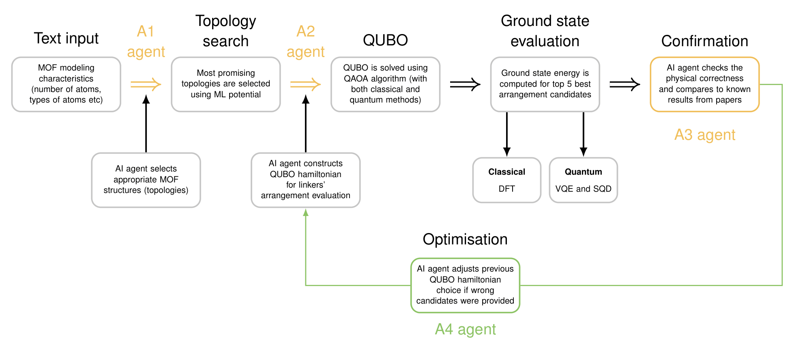

# QuMOF: quantum-enhanced modelling of multivariate MOFs

Dmitrii Zhiganov, Matvei Anoshin, Gintaras Gliaudelis

QuMOF predicts how linkers arrange in multivariate metal–organic frameworks (MTV-MOFs), starting from a plain-text design brief. LLM agents choose topologies and Hamiltonian forms, a DFT-fitted QUBO is solved by simulated annealing and composition-preserving QAOA, and the best structures are ranked by periodic DFT with quantum-embedded corrections at the metal nodes.

## Approach

MTV-MOFs carry two or more linkers on one framework, and their properties depend on how the linkers are arranged, which experiments rarely resolve. Kang et al. (ACS Cent. Sci. 2025) showed this arrangement can be written as a QUBO, but with Hamiltonian weights chosen by hand for each material. QuMOF automates the full loop and grounds it in computed energies:

1. **Topology from text.** The user provides a design brief and a project file (metal nodes, linkers, target ratio). Missing fields are reported, never invented. Agent A1 picks candidate nets, frameworks are built from CIFs, and an ML interatomic potential screens out structurally incompatible topologies.
2. **Molecule encoding.** Each variable linker site $i$ becomes a binary variable, $x_i = 1$ if it holds linker B, so an arrangement is a bit string $\mathbf{x} \in \lbrace 0,1 \rbrace^N$ at fixed composition $\sum_i x_i = N_B$.
3. **QUBO Hamiltonian.** Agent A2 chooses the model form (point and pair cluster features, encoding, QUBO or HUBO). Code fits the coefficients to estimated DFT energies with grouped cross-validation and compiles
    
    $H(\mathbf{x}) = \sum_i h_i x_i + \sum_{i<j} J_{ij}\, x_i x_j + \lambda \Big( \sum_i x_i - N_B \Big)^2 .$
    
4. **Solve.** Simulated annealing and composition-preserving QAOA are benchmarked against minima certified by exact enumeration, as a statevector simulation and as noisy sampling on Qiskit's FakeBrisbane device.
5. **Analyze.** The best arrangements are relaxed and ranked with periodic DFT (which can be replaced with just VQE/SQD). Each metal node for the ranking gets a high-level correction through subtractive embedding, from CCSD (benchmark) or an active-space solver (CASCI, VQE, SQD). Agent A3 checks the top candidates against structural tests, the CoRE MOF 2024 and QMOF databases and the literature. If the energy model fails validation, agent A4 sends the run back to step 3 with a new Hamiltonian.

Every run is reproducible: immutable artifacts, an event log, and a deterministic mode with the agents switched off. The whole pipeline was built during the hackathon.



### How the AI agents are used

- The agents make judgement calls only. All numbers come from code, and every agent answer is checked against a
  strict JSON schema before it is used.
- A normal run makes three LLM requests (A1, A2, A3) through OpenRouter. At most one extra request is allowed, either
  to repair an invalid answer or to run the A4 loop.
- **The agents are optional.** `qumof run` executes the same stages without any LLM. The project file then fixes
  which topologies and models to use.
- Two roles have different names in the code. A3 is called `A67`, and A4 is the "A2 expansion" step
  (`node_a2_expand` in [agents/runner.py](src/qumof/agents/runner.py)).

## Results

The QuMOF agentic pipeline successfully automates the discovery and optimization of MTV-MOF arrangements, demonstrated here on MUF-7 structures. As detailed in the accompanying charts:

1. Hamiltonian Generation (Left Chart): The pipeline accurately approximates the QUBO Hamiltonian for the given MUF-7 configurations, successfully replacing manual weight assignment with an automated, data-driven approach.

1. QAOA Optimization (Second & Third Charts): Solving the QUBO formulation via QAOA identifies highly optimal linker arrangements. Notably, QuMOF achieved lower pre-relaxation energies than the manually-derived Hamiltonians from the baseline literature.

1. Energy Minimization & Reconstruction (Fourth Chart): Following VQE-driven energy minimization, the pipeline exactly reconstructs the true minimal energy states. This exact reconstruction highlights the efficacy of the agentic loop (driven here by Qwen 3.8 models) in guiding the quantum solvers to the global minimum.


## Quick start

You only need Python 3.10 or newer. No other packages are required for this step.

```bash
PYTHONPATH=src python3 -m qumof matrix --project mof_no_agent_fixture/project.json --out runs
```

This runs the whole pipeline on a small synthetic test problem whose answer is known. It runs 6 times (2 problems × 3
correction modes) and checks each run against the answer. It takes a few seconds, and every row should end with
`"acceptance": "PASS"`.

## Installation

Python 3.10 or newer is required. On Linux:

```bash
python3 -m venv .venv
source .venv/bin/activate
pip install -e ".[test]"        # core package + PySCF, pyscf-dispersion, ASE, pytest
```

Install the optional extras you need:

| Extra | Enables | Main packages |
|---|---|---|
| `agents` | AI agents A1–A4, literature and database lookup | requests, jsonschema, langgraph, mcp, pandas, h5py |
| `mlip` | ML-potential screening and relaxation | orb-models |
| `topology` | building frameworks from PORMAKE nets and blocks | pormake |
| `qpu` | QAOA on fake IBM devices | qiskit, qiskit-aer, qiskit-ibm-runtime |
| `aiida` | AiiDA workflow engine with provenance | aiida-core |
| `gpu` | DFT on a GPU (untested) | gpu4pyscf-cuda12x |

```bash
pip install -e ".[agents,mlip,qpu]"

# AiiDA only: create a local profile once (no database server or broker needed)
pip install -e ".[aiida]"
AIIDA_PATH=$PWD/.aiida verdi presto --profile-name qumof
```

The package still imports without the extras. Each optional component loads only when it is used. `orb-models` needs
Python 3.13 or older; if your main interpreter is newer, install it into a separate environment and point
`protocols.ml_potential_checkpoint.python` in the project file at it.

> [!NOTE]
> **macOS on Apple silicon:** `pyscf-dispersion` has no wheel for this platform, so a plain `pip install -e .` fails.
> Install the package with `--no-deps`, then add the dependencies yourself, leaving out `pyscf-dispersion`:
>
> ```bash
> pip install -e . --no-deps
> pip install "pyscf>=2.14" "ase>=3.23" pytest
> ```
>
> Do the same for an extra: register it with `pip install -e ".[agents]" --no-deps`, then install the packages it lists
> in [pyproject.toml](pyproject.toml). Without `pyscf-dispersion`, DFT-D3/D4 dispersion corrections are unavailable.

## Usage

Run every command from the repository root. Run directories go to `runs/`, which git ignores. Commands written with
`python3` need no extra packages. Commands written with `python` expect the virtual environment from
[Installation](#installation) to be active.

A project is described by a `project.json` file: the parent crystal structures (CIFs), the metals and linkers, the
target composition and the DFT settings. The template is
[project_spec.template.json](project_spec.template.json). The pipeline validates the project
first; if a scientific input is missing, it stops with a named error such as `SCIENTIFIC_SPEC_MISSING`.

### 1. Synthetic test problem (no dependencies)

[mof_no_agent_fixture/](mof_no_agent_fixture/) contains two abstract 12-site graphs, `ring12` and `prism6`. They are
test problems with a known answer, not real MOFs.

```bash
# One run: the problem with three-body interactions and a topology-dependent correction
PYTHONPATH=src python3 -m qumof run --project mof_no_agent_fixture/project.json \
    --case higher_order --correction topology_dependent

# One run, then compare the result with the known answer
PYTHONPATH=src python3 -m qumof accept --project mof_no_agent_fixture/project.json

# All 6 combinations, each run and checked
PYTHONPATH=src python3 -m qumof matrix --project mof_no_agent_fixture/project.json --out runs
```

### 2. Toy frameworks with a mock DFT code

These toys run the physical path (CIF → framework → DFT energies → model → ranking) with a fake DFT program. They test
the plumbing, not the physics. The second toy takes about 30 seconds.

```bash
# Write two toy projects: runs/toy_b (one topology) and runs/toy_c (two topologies, supercell, refinement)
python3 -c "import sys; sys.path[:0] = ['tests']; import toy_framework as t; \
print(t.write_toy_project('runs/toy_b'), t.write_toy_milestone_c_project('runs/toy_c'))"

PYTHONPATH=src python3 -m qumof run --project runs/toy_c/project.json
```

### 3. Real DFT on a toy (PySCF)

```bash
# Write a synthetic aluminium-formate project that uses the real PySCF engine
python tests/pyscf_toy.py runs/toy_pyscf

PYTHONPATH=src python -m qumof run --project runs/toy_pyscf/project.json
```

With the shipped 25 Ha cutoff, the convergence check stops this run on purpose with `DFT_SETTINGS_NOT_CONVERGED`
(about 10 minutes). For a complete run, raise `ke_cutoff_Ha` and the cutoff series to about 100 Ha in the project file.

### 4. An incomplete project

```bash
# Loads as a physical project, then stops at intake and lists the missing fields
PYTHONPATH=src python3 -m qumof run --project mof_no_agent_fixture/physical_case/recipe.json
```

### 5. Quantum chemistry benchmarks

```bash
# H2 in a minimal basis: exact diagonalisation, CASCI, VQE and SQD on the same Hamiltonian,
# compared with the textbook values (Szabo & Ostlund)
PYTHONPATH=src python -m qumof electronic-benchmark \
    --spec benchmarks/h2_sto3g_szabo_ostlund.json --run-dir runs/h2_benchmark

# Cluster embedding (HF corrected to CCSD) on keto/enol tautomers,
# compared with an independent CCSD calculation on the whole molecule
PYTHONPATH=src python -m qumof embedding-benchmark \
    --spec benchmarks/embedding_keto_enol_hf_ccsd.json --run-dir runs/embedding_benchmark
```

### 6. With the AI agents

Set up once:

```bash
pip install -e ".[agents]"

# Copy the example settings and fill in your OpenRouter key and Valency token.
# controls.yaml is gitignored. Alternatively, set OPENROUTER_API_KEY, OPENROUTER_MODEL and VALENCY_API_TOKEN.
cp controls_example.yaml controls.yaml

# Check the key, the model and the Valency connection
PYTHONPATH=src python -m qumof agents-check

# Download pinned copies of the CoRE MOF 2024 and QMOF databases into data/reference/ (used by A3)
PYTHONPATH=src python -m qumof datasets-fetch
```

The example settings use `qwen/qwen3.8-flash`. The code has no default model, so `openrouter.model` (or
`OPENROUTER_MODEL`) must be set.

Then run:

```bash
# Full run: A1 picks topologies, A2 designs the model, the pipeline runs, A3 writes the assessment
PYTHONPATH=src python -m qumof agents --project mof_no_agent_fixture/project.json \
    --case higher_order --correction topology_dependent --brief "What the study is about"

# Same, but replay saved agent answers instead of calling the API
PYTHONPATH=src python -m qumof agents --project mof_no_agent_fixture/project.json --replay answers.json

# Compare runs with and without agents at the same budget
PYTHONPATH=src python -m qumof agents-eval --project mof_no_agent_fixture/project.json
```

To turn on the A4 feedback loop, set `budget.allow_model_expansion: true` in `controls.yaml`.

### 7. Benchmark: Kang et al. (2025)

Kang, Kim & Kim (*ACS Cent. Sci.* 2025, [doi:10.1021/acscentsci.5c00918](https://doi.org/10.1021/acscentsci.5c00918))
used a hand-built Hamiltonian and VQE to predict linker arrangements in three materials: Cu-THQ-HHTP, Py-MV-DBA-COF
and MUF-7. [benchmarks/kang2025/](benchmarks/kang2025/) contains their inputs: the site graph, edge distances, linker
lengths and composition.

In this benchmark, A2 builds the Hamiltonian itself from a small catalogue of terms. Code computes the coefficients and
solves the problem exactly and with QAOA. The result is scored against the experimental arrangement, which the model
never sees.

```bash
# The paper's own weighting through the same code; no LLM calls (still reads a controls file)
PYTHONPATH=src python -m qumof agents-design-bench --control-only --controls controls_example.yaml

# Two Qwen models, 3 repeats each; also sample every design on the fake IBM device
PYTHONPATH=src python -m qumof agents-design-bench \
    --models qwen/qwen3.8-flash,qwen/qwen3.8-max-0902 \
    --repeats 3 --reasoning-effort low --qpu-python .venv/bin/python
```

The control run reproduces the paper's energy spectrum for all three materials (Spearman ρ = 1.000). With that
Hamiltonian, QAOA samples the experimental arrangement with a median probability of 0.25–0.49. A uniform random pick
among arrangements with the right composition gives 0.03–0.10. Results land in `runs/kang2025_design/results.md`. The
fourth material in the paper, SIOC-COF2, is not included, because its graph could not be reconstructed.

#### MUF-7 with real structures

[run_muf7_full.py](benchmarks/kang2025/run_muf7_full.py) takes MUF-7 through the full scheme behind the
[Results](#results): A2 designs the Hamiltonian, the QUBO is solved exactly and with QAOA, the top arrangements are
built with PORMAKE (Zn4O + BTB on `ith-d`, BDC/BPDC on the six variable edges), relaxed with orb-v3 + D3(BJ), and a
Zn4O(HCO2)6 cluster cut from each relaxed structure is checked with HF + CAS(4,4) VQE and SQD. It needs the `agents`,
`mlip` and `topology` extras and PySCF in one environment.

```bash
PYTHONPATH=src .venv/bin/python benchmarks/kang2025/run_muf7_full.py \
    --models qwen/qwen3.8-max-0902,qwen/qwen3.8-flash --repeats 3 --top-k 5 --out runs/muf7_full
```

This run is approximate: ML-potential energies stand in for DFT, the cells are translation-only, and the cluster
VQE/SQD is a local electronic check rather than the arrangement energy. The script's docstring lists every
approximation.

### Optional features

ML-potential screening is set in the project file under `protocols.ml_potential_checkpoint`
(`protocols.ml_calibration` and `protocols.screening` set the calibration and the decision policy):

```json
{"engine": "orb", "model": "orb-v3-conservative-inf-omat", "dispersion": "D3BJ", "python": ".venv/bin/python",
 "relaxation": {"optimizer": "FIRE", "fmax_eV_per_A": 0.05, "max_steps": 400, "cell": "variable"}}
```

ToBaCCo is refused (`UNSUPPORTED_TOPOLOGY_BUILDER`): it is a script repository, not an installable package.

To run any project on the AiiDA engine and record the provenance of every stage:

```bash
PYTHONPATH=src python -m qumof run --engine aiida --project <project.json>
```

## Tests

```bash
python -m pytest -m "not pyscf"                                  # everything except real DFT (~4 minutes)
python -m pytest -m pyscf                                        # real PySCF calculations (minutes)
QUMOF_SLOW_TESTS=1 python -m pytest -m pyscf -k end_to_end     # full PySCF pipeline run on the toy (opt-in)
```

The agent tests need the `agents` extra. They replay saved answers and do not use the network.

## What a run produces

A pipeline run directory contains:

| Path | Contents |
|---|---|
| `report.md`, `report.json` | the result: ranking, chosen models, the status of every stage |
| `state.json` | the workflow state |
| `events.jsonl` | the event log |
| `artifacts/` | intermediate results, stored by content hash and never overwritten |
| `jobs/` | DFT and evaluator inputs, raw outputs and logs |

Rerunning with the same inputs reuses finished stages and never resubmits a successful job.

An agent run adds `agent/` (the agents' inputs, answers and request ledger), `pipeline/` (the ordinary run),
`assessment.md` (A3's verdict) and `agent_run.json` (a summary).

## Repository layout

| Path | Contents |
|---|---|
| [src/qumof/](src/qumof/) | the pipeline |
| [src/qumof/agents/](src/qumof/agents/) | the AI agents: prompts, schemas, OpenRouter client, literature and database lookup |
| [tests/](tests/) | test suite, mock DFT and ML programs, toy project generators |
| [mof_no_agent_fixture/](mof_no_agent_fixture/) | synthetic test problem with known answers |
| [benchmarks/](benchmarks/) | H2, embedding and Kang et al. benchmark inputs, MUF-7 full-scheme runner |
| [project_spec.template.json](project_spec.template.json) | the project file template |
| [controls_example.yaml](controls_example.yaml) | example settings for the agents |

<details>
<summary>Module map: which file implements which step</summary>

| Step | What | Module |
|---|---|---|
| 1 | project validation | `intake.py`, `project_spec.py` |
| 1 | CIF parsing, framework building, supercells | `cif.py`, `framework.py` |
| 1 | topology screening with an ML potential | `screening.py`, `mlip.py`, `mlip_worker.py` |
| 2 | arrangement space and symmetry | `structures.py` |
| 3 | DFT labels, dataset snapshots, frozen train/test split | `datasets.py` |
| 3 | cluster features on the parent lattice | `clusters.py` |
| 3 | model fitting and selection | `configuration_model.py` |
| 3 | transfer to larger supercells | `transfer.py` |
| 3 | QUBO/HUBO compilation, cubic-to-quadratic reduction, constraints | `encoding.py` |
| 4 | exact enumeration, branch and bound, simulated annealing | `optimization.py` |
| 4 | QAOA (statevector simulation) | `qaoa.py` |
| 4 | symmetry deduplication, candidate pool, geometry matching | `candidates.py`, `geometry_match.py` |
| 5 | choosing which structures get new DFT data | `acquisition.py` |
| 5 | periodic DFT and cutoff convergence | `dft.py`, `pyscf_worker.py` |
| 5 | active spaces; ED, CASCI, VQE, SQD | `active_space.py`, `electronic_solvers.py`, `electronic.py` |
| 5 | cluster embedding | `embedding.py`, `cluster_worker.py` |
| 5 | refinement rounds | `refinement.py`, `orchestrator.py` |
| 5 | ranking, reference phases, structural checks, report | `ranking.py`, `references.py`, `validation.py`, `report.py` |
| A1–A4 | validation of agent answers | `gateway.py` |
| A1–A4 | agent runtime | `agents/` |
| — | AiiDA engine, run storage | `aiida_engine.py`, `store.py` |

Step numbers refer to the list in [Approach](#approach).

</details>

## Limitations

- Quantum algorithms run on simulators and on fake (simulated, noisy) IBM devices, not on real quantum hardware.
- The pipeline-level checks run on synthetic toy frameworks; the MUF-7 run uses ML-potential energies in place of DFT.
- GPU DFT (`gpu` extra) is untested.
- A check that did not run is reported as `SKIPPED_*`, `DISABLED_BY_CONFIG`, `NOT_RUN` or `INCOMPLETE`, never as passed.

## Next steps

- Run quantum parts on actual quantum hardware for open-shell metal nodes, and scale to larger frameworks and three or more linker types
- Further fine-tuning of implemented AI agents and speedup of optimization loop
- New implementations, such as predictions of finite-temperature arrangement ensembles for comparison with NMR, and addition of a property-driven loop
- Release the fitted Hamiltonians as benchmark instances. Because the QUBO and node Hamiltonians are solver-agnostic, the pipeline can move to stronger quantum hardware without rebuilding

## License

[CC0 1.0](LICENSE) (public domain dedication).
